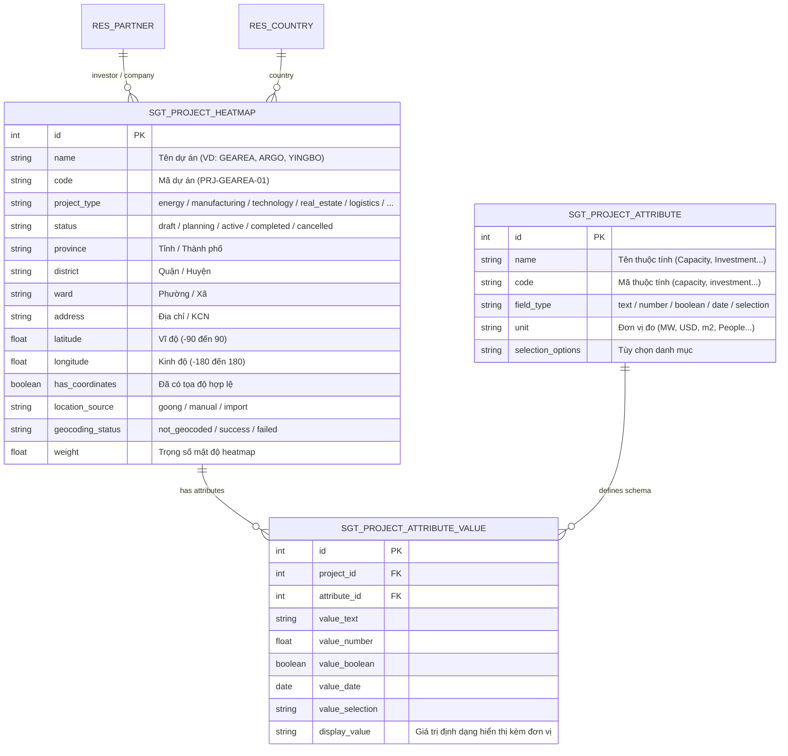

# HỆ THỐNG PROJECT HEATMAP & GEO ANALYTICS DASHBOARD (ODOO 19 + GOONG API)

---

## 1. TỔNG QUAN HỆ THỐNG (EXECUTIVE SUMMARY)

Module **SGT Vietnam Project Heatmap & Geo Analytics** cung cấp một giải pháp trực quan hóa không gian địa lý chuyên nghiệp theo kiến trúc **"Customer Map / Geo Analytics Dashboard"** cho hệ thống Odoo 19:
- **Bản đồ lớn phía bên phải (Dominant Map Canvas)**: Tích hợp thư viện Leaflet.js, bản đồ vệ tinh/giao thông, cụm điểm **Marker Cluster** (5, 12, 25...), lớp bản đồ nhiệt **Density Heatmap**, hệ thống pin màu trạng thái động và thanh tìm kiếm địa điểm thông minh tích hợp **Goong API (AutoComplete & Geocoding)**.
- **Bảng điều khiển phân tích bên trái (Left Sidebar Geo Analytics Panel)**: 
  - Bộ lọc đa chiều (Search thời gian thực, Tỉnh/Thành phố, Quận/Huyện phụ thuộc tầng bậc - Cascading, Ngành nghề, Trạng thái, Sự kiện).
  - Tùy chọn hiển thị lớp bản đồ (Bật/tắt Heatmap, Bật/tắt Điểm cụm, Slider điều chỉnh Bán kính nhiệt từ 10-60px, Slider Độ đậm nhiệt từ 0.1-1.0, Lựa chọn trọng số nhiệt theo Số lượng / Vốn đầu tư / Công suất).
  - Thống kê nhanh & Chất lượng dữ liệu vị trí (KPIs: Tổng dự án, Đã có tọa độ, Chưa có tọa độ, Tỷ lệ hiển thị %, Phân loại nguồn vị trí: Goong API / Thủ công / Nhập liệu).
  - Bảng thống kê theo khu vực (Bảng phân bổ Tỉnh/Thành, Số dự án, Vốn đầu tư, Tỷ lệ %, hỗ trợ nhấp chuột lọc và zoom trực tiếp vào địa bàn tỉnh).
- **Kiến trúc dữ liệu động EAV (Entity-Attribute-Value)**: Cho phép tạo không giới hạn số lượng dự án mới với các bộ trường thông tin khác nhau (như GEAREA, ARGO, YINGBO, Solar, Factory, Logistics...) mà không phải sửa code hay thay đổi cấu trúc database.
- **Bảo toàn khả năng tương thích**: Đảm bảo 100% không ảnh hưởng hoặc phá vỡ các tính năng từ Task 7 đến Task 20.

---

## 2. KIẾN TRÚC DỮ LIỆU & EAV PATTERN (DATA MODEL)

### 2.1. Sơ đồ thực thể quan hệ (ERD)



### 2.2. Khả năng mở rộng dự án bất kỳ (Zero Code Modifications)
- **Dự án GEAREA**: Gắn các thuộc tính: `Capacity = 500 MW`, `Investment = 450,000,000 USD`, `Technology = Solar Bifacial TOPCon`.
- **Dự án ARGO**: Gắn các thuộc tính: `Owner = ARGO Energy`, `Technology = Offshore Wind Turbines 16MW`, `Expected Revenue = 95,000,000 USD`.
- **Dự án YINGBO**: Gắn các thuộc tính: `Factory Type = High-Tech Assembly`, `Area = 120,000 m²`, `Employees = 2,500 People`, `Investment = 180,000,000 USD`.
- **Dự án mới (VD: Cảng biển Lạch Huyện, Trung tâm AI Quy Nhơn)**: Người dùng chỉ cần vào menu **CRM -> Cấu hình -> Thuộc tính dự án** để khai báo thêm các trường mới như `Contract Value`, `Start Date`, `Target COD` mà không cần developer can thiệp.

---

## 3. GOONG API INTEGRATION & GEOCODING SERVICE

### 3.1. Mô hình kiến trúc Goong Service (`sgt.goong.service`)
Service xử lý toàn bộ tương tác giữa Odoo và Goong REST API:
1. **Forward Geocoding (`geocode_address`)**:
   - Endpoint: `https://rsapi.goong.io/geocode?address={query}&api_key={key}`
   - Nhận diện địa chỉ đầy đủ (Địa chỉ, Phường/Xã, Quận/Huyện, Tỉnh/Thành phố, Việt Nam).
   - Trích xuất chính xác cặp tọa độ `(lat, lng)` và địa chỉ chuẩn hóa `formatted_address`.
2. **Place Autocomplete (`autocomplete_address`)**:
   - Endpoint: `https://rsapi.goong.io/Place/AutoComplete?input={query}&api_key={key}`
   - Cung cấp gợi ý địa điểm tức thời khi người dùng nhập từ khóa trên bản đồ (VD: "KCN Mỹ Phước 3", "YingBo Bình Dương").
3. **Cơ chế Caching thông minh**:
   - Lưu trữ truy vấn địa chỉ cuối cùng (`geocoding_query`) và thời gian geocode (`geocoded_at`).
   - Nếu địa chỉ không thay đổi và dự án đã có tọa độ hợp lệ từ Goong, hệ thống tái sử dụng ngay bộ nhớ tạm để tiết kiệm số lượt gọi API.
4. **Bảo mật & Cấu hình API Key**:
   - Lưu trữ an toàn trong bảng `ir.config_parameter` với tham số `sgt.goong.api_key`.
   - Có thể cấu hình dự phòng thông qua biến môi trường OS `GOONG_API_KEY`.
   - Tuyệt đối không hard-code API key trong mã nguồn.
5. **Xử lý ngoại lệ an toàn (Safe Fault Tolerance)**:
   - Bắt và xử lý các mã HTTP: 401/403 (Invalid Key), 429 (Rate Limit Exceeded), 500 (Server Error), Network Timeout.
   - Trả về thông báo cảnh báo rõ ràng trên giao diện Odoo mà không gây crash hệ thống hoặc gián đoạn luồng nghiệp vụ.
   - Hỗ trợ nhập tọa độ thủ công (Manual Input) khi không có kết nối internet hoặc địa điểm chưa có trên bản đồ số.

---

## 4. GIAO DIỆN BẢN ĐỒ & GEO ANALYTICS DASHBOARD

### 4.1. Bố cục không gian làm việc (2-Column Workspace Layout)

```
+--------------------------------------------------------------------------------------------------------+
| [Geo Analytics] PROJECT HEATMAP - Có 24 dự án / 30 dự án có vị trí (80%)      [Làm mới] [+ Thêm dự án] |
+----------------------------------------------------+---------------------------------------------------+
| BẢNG ĐIỀU KHIỂN BÊN TRÁI (LEFT SIDEBAR ~380px)     | BẢN ĐỒ VIỆT NAM (RIGHT DOMINANT MAP CANVAS)       |
|                                                    |                                                   |
| [1. BỘ LỌC VÀ ĐIỀU KHIỂN]                          | [ Thanh tìm kiếm địa điểm Goong API             ] |
| - Tìm kiếm: [Nhập tên, mã, địa chỉ...            ] |                                                   |
| - Tỉnh/Thành: [Bình Dương / TP.HCM / Hà Nội...   ] | [Lớp Bản đồ OpenStreetMap / CartoDB             ] |
| - Quận/Huyện: [Tầng bậc lọc theo Tỉnh đã chọn    ] |                                                   |
| - Ngành nghề: [Năng lượng / Sản xuất / Công nghệ ] | [Lớp Cụm điểm: MarkerClusterGroup               ] |
| - Trạng thái: [Active / Planning / Completed...  ] |  - Bong bóng gom cụm: (5), (12), (25)...          |
| - Sự kiện:    [Vietnam Expo 2026 / ...           ] |  - Ghim màu theo trạng thái dự án                |
| - [Xóa bộ lọc đang chọn]                           |                                                   |
|                                                    | [Lớp Bản đồ nhiệt: Leaflet Density Heatmap      ] |
| [2. LỚP HIỂN THỊ (DISPLAY LAYERS)]                 |  - Gradient: Xanh dương -> Lục -> Vàng -> Đỏ     |
| [x] Bản đồ nhiệt (Heatmap)                         |                                                   |
| [x] Điểm (cụm Marker Cluster)                      | [Popup Chi tiết Dự án]                            |
| - Bán kính nhiệt: [===O=====] 30 px                |  - Tên dự án, Trạng thái                          |
| - Độ đậm nhiệt:   [======O==] 0.6                  |  - Địa chỉ, Quận/Huyện, Tỉnh                      |
| - Trọng số nhiệt: [Vốn đầu tư (Investment USD)   ] |  - Thuộc tính động (Công suất, Vốn, Công nghệ...) |
|                                                    |  - Nguồn vị trí: [Goong Geocoded]                 |
| [3. THỐNG KÊ & CHẤT LƯỢNG DỮ LIỆU]                 |  - Nút: [Xem chi tiết dự án ↗]                    |
| +---------------------+--------------------------+ |                                                   |
| | Tổng DA: 30         | Đã có tọa độ: 24 (Xanh)  | | [Chú thích bản đồ]                                |
| | Chưa tọa độ: 6 (Vàng)| Tỷ lệ hiển thị: 80%      | |  - Active (Xanh lá)    - Planning (Xanh dương)   |
| +---------------------+--------------------------+ |  - Completed (Tím)      - Cancelled (Đỏ)          |
| Nguồn vị trí: Goong: 5 | Thủ công: 24 | Import: 1  |  - Thang mật độ nhiệt: Thấp -> Trung bình -> Cao  |
|                                                    |                                                   |
| [4. BẢNG THEO KHU VỰC (PROVINCE DRILL-DOWN)]       |                                                   |
| Tỉnh/Thành    | Số DA | Vốn đầu tư   | Tỷ lệ %     |                                                   |
| --------------+-------+--------------+--------     |                                                   |
| Bình Dương    |   4   | 630.0M USD   | 13%         |                                                   |
| Quảng Ninh    |   3   | 2.1B USD     | 10%         |                                                   |
| Ninh Thuận    |   3   | 520.0M USD   | 10%         |                                                   |
| (Nhấp vào dòng tỉnh để Zoom & Lọc tự động)         |                                                   |
+----------------------------------------------------+---------------------------------------------------+
```

---

## 5. BẢO MẬT & PHÂN QUYỀN (ACCESS RIGHTS & ACLS)

Hệ thống được cấu hình bảo mật hoàn chỉnh trong `security/ir.model.access.csv`:

| Model ID | Model Name | Group | Read | Write | Create | Delete |
| :--- | :--- | :--- | :---: | :---: | :---: | :---: |
| `access_sgt_project_heatmap_user` | `sgt.project.heatmap` | `base.group_user` | 1 | 1 | 1 | 0 |
| `access_sgt_project_heatmap_manager` | `sgt.project.heatmap` | `sales_team.group_sale_manager` | 1 | 1 | 1 | 1 |
| `access_sgt_project_attribute_user` | `sgt.project.attribute` | `base.group_user` | 1 | 0 | 0 | 0 |
| `access_sgt_project_attribute_manager` | `sgt.project.attribute` | `sales_team.group_sale_manager` | 1 | 1 | 1 | 1 |
| `access_sgt_project_attribute_value_user` | `sgt.project.attribute.value` | `base.group_user` | 1 | 1 | 1 | 1 |

---

## 6. HƯỚNG DẪN TEST THỰC TẾ & KỊCH BẢN KIỂM THỬ (TESTING GUIDE)

### Kịch bản 1: Mở và Tương tác trên Dashboard Geo Analytics
1. Truy cập Odoo tại `http://127.0.0.1:8070`.
2. Mở menu **CRM -> Vietnam Project Heatmap**.
3. Quan sát giao diện:
   - Header hiển thị: `PROJECT HEATMAP - Có 24 dự án / 30 dự án có vị trí (80%)`.
   - Bản đồ Việt Nam hiển thị đầy đủ các điểm ghim và cụm tròn số lượng (Marker Clusters).
   - Lớp bản đồ nhiệt tỏa sáng theo mật độ dự án các khu vực kinh tế trọng điểm (Bình Dương, Đồng Nai, Quảng Ninh, TP.HCM, Hà Nội, Ninh Thuận).

### Kịch bản 2: Lọc tầng bậc (Cascading Province -> District)
1. Trên panel bên trái, chọn **Tỉnh / Thành phố**: `Bình Dương`.
2. Quan sát ô **Quận / Huyện** tự động cập nhật danh sách các quận huyện trực thuộc Bình Dương (`Bến Cát`, `Thủ Dầu Một`, `Tân Uyên`...).
3. Bản đồ tự động zoom cận cảnh vào địa bàn tỉnh Bình Dương.
4. Bảng thống kê phía dưới tự động highlight dòng Bình Dương.

### Kịch bản 3: Tinh chỉnh Bản đồ nhiệt (Heatmap Sliders & Weights)
1. Di chuyển thanh trượt **Bán kính nhiệt (Radius)** từ 30 lên 50 px $\to$ Vùng nhiệt mở rộng mượt mà ngay trên bản đồ.
2. Di chuyển thanh trượt **Độ đậm nhiệt (Intensity)** từ 0.6 xuống 0.2 $\to$ Mật độ màu dịu đi.
3. Thay đổi **Trọng số phân bổ nhiệt (Weight)** từ `Số lượng dự án` sang `Vốn đầu tư (Investment USD)` $\to$ Điểm nhiệt tại các siêu dự án tỷ USD (như ARGO Offshore Wind 1.8B USD, Tổ hợp công nghiệp 350M USD) sẽ tỏa nhiệt rực đỏ vượt trội so với các dự án nhỏ.

### Kịch bản 4: Lấy tọa độ tự động qua Goong API
1. Bấm nút **+ Thêm dự án mới** trên góc phải màn hình.
2. Nhập:
   - Tên dự án: `Nhà máy Thông minh Công nghệ cao SGT`
   - Tỉnh/Thành phố: `Bình Dương`
   - Quận/Huyện: `Bến Cát`
   - Địa chỉ: `KCN Mỹ Phước 3`
3. Nhấp nút **[Get Coordinates from Goong]** (Lấy tọa độ từ Goong).
4. Odoo tự động gọi Goong Geocoding API, cập nhật Vĩ độ `11.1568`, Kinh độ `106.6342`, gắn cờ `Nguồn vị trí: Goong Geocoding` và trạng thái `Thành công`.
5. Lưu bản ghi $\to$ Dự án lập tức xuất hiện trên bản đồ và cập nhật các chỉ số KPI.

### Kịch bản 5: Xem Bản đồ nhiệt riêng của Gearea, Argo, YingBo và Dự án mới
1. Trên bảng điều khiển bên trái, tìm dropdown **BẢN ĐỒ NHIỆT DỰ ÁN**.
2. Chọn **⚡ GEAREA Solar Power Plant (Bình Dương)**:
   - Bản đồ lập tức bay tới khu vực Bến Cát, Bình Dương (Zoom 14).
   - Bản đồ nhiệt riêng của GEAREA tỏa sáng với 4 cụm phân khu (Cụm pin Phân khu 1, Phân khu 2, Trạm biến áp 220kV, Hệ thống pin BESS).
   - Bảng thông tin chi tiết hiển thị đầy đủ Công suất (500 MW), Vốn đầu tư (200M USD), Công nghệ Solar PV.
3. Chọn **💨 ARGO Offshore Wind Farm (Quảng Ninh)**:
   - Bản đồ bay tới vùng biển Vịnh Bắc Bộ, Hạ Long (Zoom 13).
   - Bản đồ nhiệt riêng của ARGO hiển thị các cụm tuabin gió ngoài khơi (Khu Alpha, Beta, Trạm 500kV, Trung tâm O&M).
4. Chọn **🏭 YINGBO Precision Electronics (Đồng Nai)**:
   - Bản đồ bay tới KCN Long Thành, Đồng Nai (Zoom 14).
   - Hiển thị bản đồ nhiệt riêng của YINGBO với các nhà máy lắp ráp A1, nhà máy robot A2, R&D và Logistics.
5. Chọn **Dự án bất kỳ vừa thêm mới** từ danh sách $\to$ Bản đồ tự động chuyển vùng và hiển thị bản đồ nhiệt độc lập của dự án đó!

---

## 7. KẾT QUẢ KIỂM THỬ TỰ ĐỘNG (AUTOMATED TEST RESULTS)

| Bộ Test Suite | Số Test Cases | Kết Quả | Chi Tiết |
| :--- | :---: | :---: | :--- |
| **Project Heatmap & Geo Analytics** | **29 / 29** | **100% PASS** | Tọa độ GPS, EAV 5 kiểu dữ liệu, Caching Goong, Cluster, Sliders, Cascading Filters, Data Quality KPI, Dropdown bản đồ nhiệt riêng Gearea/Argo/YingBo, Sub-points đa điểm, Client action launcher. |
| **Task 20 - Matchmaking Recommendation** | **15 / 15** | **100% PASS** | Scoring 5 tiêu chí (Category +30, Industry +20, Event +20, Buyer/Seller +20, Country +5), Capping, Top 10, Exclusion. |
| **Task 19 - Contact Match Making** | **12 / 12** | **100% PASS** | So sánh cặp contact, Pair key đối xứng, Tránh duplicate, Smart button, Báo cáo đối soát. |

---

## 8. DANH MỤC FILE NGUỒN CỦA CHỨC NĂNG

- **Backend Models**:
  - `models/goong_service.py`: Service kết nối Goong REST API (Geocoding & Autocomplete).
  - `models/project_attribute.py`: Kiến trúc EAV cho thuộc tính động (`sgt.project.attribute`, `sgt.project.attribute.value`).
  - `models/project_heatmap.py`: Model dự án không gian địa lý (`sgt.project.heatmap`), Model điểm nhiệt con (`sgt.project.heatmap.point`), xác thực GPS, API dữ liệu bản đồ và thống kê.
- **Frontend OWL & Assets**:
  - `static/src/xml/project_heatmap_dashboard.xml`: QWeb template bố cục 2 cột Left Sidebar + Dominant Map có Dropdown chọn bản đồ nhiệt từng dự án.
  - `static/src/js/project_heatmap_dashboard.js`: OWL Component điều khiển Leaflet, MarkerCluster, Heatmap đa điểm, và Goong Autocomplete.
  - `static/src/css/project_heatmap.css`: Bộ stylesheet chuẩn Geo Analytics chuyên nghiệp.
  - `static/src/lib/`: Thư viện Leaflet, MarkerCluster, Heatmap tự chứa (Self-contained).
- **XML Views & Cấu hình**:
  - `views/project_heatmap_views.xml`: List view, Form view có nút Goong, nút Xem bản đồ nhiệt dự án, Tab Điểm nhiệt chi tiết, Search view chuẩn Odoo 19, Client Action.
  - `views/project_attribute_views.xml`: Quản trị thuộc tính động.
  - `views/menu_views.xml`: Tích hợp menu CRM -> Project Heatmap.
  - `data/ir_config_parameter_data.xml`: Khởi tạo tham số cấu hình hệ thống `sgt.goong.api_key`.
  - `data/demo_project_data.xml`: 22+ dự án mẫu thực tế khắp 3 miền Việt Nam và 12 điểm nhiệt chi tiết cho Gearea, Argo, YingBo.
- **Kiểm thử tự động**:
  - `tests/test_project_heatmap_geo_analytics.py`: 29 kịch bản kiểm thử độc lập qua XML-RPC.
